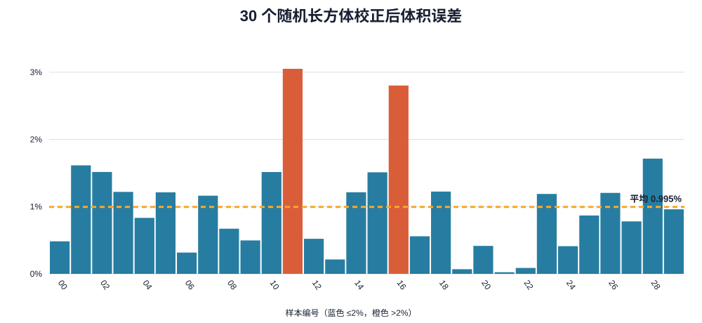
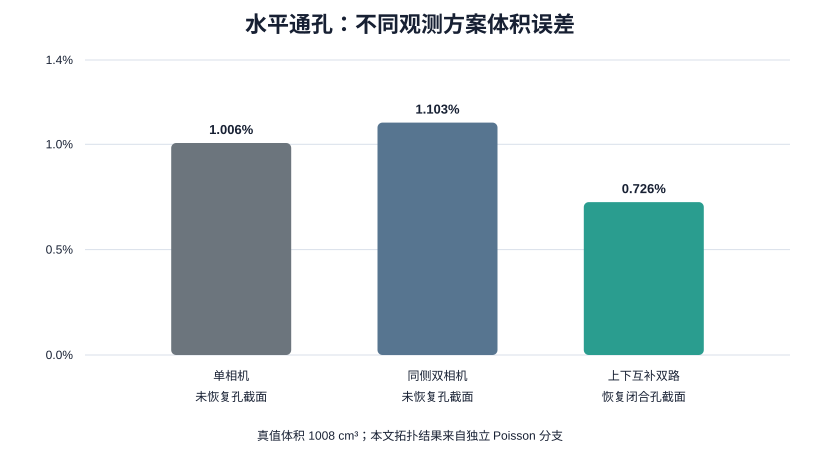
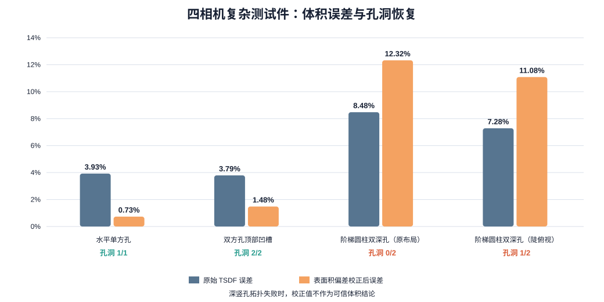
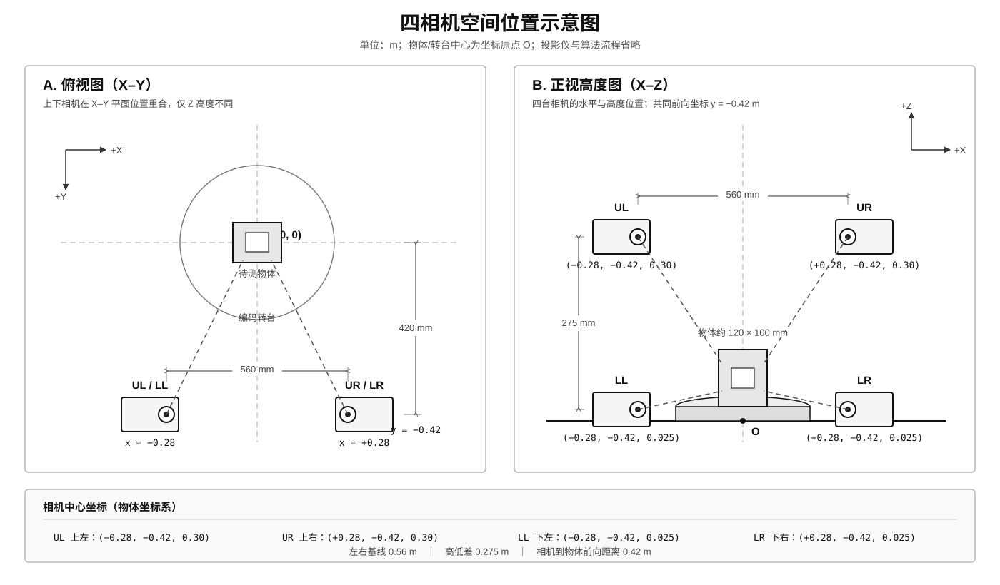
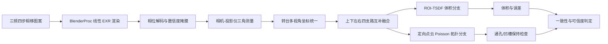

# 赛题二多视角相移结构光体积测量仿真平台

本仓库面向第十五届全国大学生光电设计竞赛赛题二，使用 BlenderProc/Cycles 构建可复现的多视角相移结构光仿真与三维体积测量链路。系统不是调用商业三维扫描仪的黑盒结果，而是从条纹生成、光学渲染、相位解码、相机—投影仪三角测量、多视角融合一直计算到体积和拓扑指标。

> 当前公开结果是**仿真实验结果**，不是实物系统精度声明。仓库保留失败实验、非闭合网格状态和 Poisson 体积失真等限制，避免只展示有利结果。

## 已完成的主要成果

| 实验 | 结果 | 说明 |
| --- | ---: | --- |
| 30 个随机长方体 | 平均体积误差 **0.995%** | 30/30 成功；中位数 0.915%，P95 2.313% |
| 随机长方体 | **93.3%** 样本误差不超过 2% | 尺寸和真值见公开 CSV |
| 标准立方体 | 体积误差 **0.439%** | 用于检查标定和尺度一致性 |
| L 形非凸物体 | 校正后体积误差 **0.388%** | TSDF 主体网格体积；凸包结果被明确判为不适用 |
| 水平通孔：单相机基线 | 体积误差 **1.006%**，孔拓扑未闭合 | 12 个转台视角 |
| 水平通孔：同侧双相机 | 体积误差 **1.103%**，孔拓扑未闭合 | 两相机均位于物体上方，共同受投影遮挡限制 |
| 水平通孔：本文上下互补双路 | 体积误差 **0.726%** | ROI 约束 TSDF + 表面积偏差校正 |
| 水平通孔：本文拓扑分支 | 恢复 **40.69 × 40.54 mm** 闭合孔截面 | 真值 40 × 40 mm；定向点云 Poisson 仅用于拓扑/展示 |
| 水平通孔：四相机阵列 | 体积误差 **0.732%**，恢复 **40.33 × 40.51 mm** 闭合孔 | 与最佳上下双路体积精度基本持平，增加左右冗余覆盖 |
| 双方孔 + 顶部凹槽 | 体积误差 **1.482%**，恢复 **2/2** 个目标孔 | 四个孔尺寸方向平均误差约 4.97% |
| 阶梯圆柱双深孔 | **失败边界**：原布局 0/2，陡俯视 1/2 | 深孔拓扑未可靠恢复；不把校正体积包装为成功结果 |

在同一水平通孔任务、同一真值体积 1008 cm³ 下，本文上下互补双路方案相对单相机将体积相对误差降低约 **27.9%**，相对同侧双相机降低约 **34.2%**；同时基线方法没有形成有效闭合孔截面，而本文拓扑分支恢复了接近真值尺寸的闭合内孔曲线。

四相机扩展在该单孔任务上的体积误差为 0.732%，与最佳上下互补双路 0.726% 基本持平；它的主要收益是左右冗余覆盖，并在“双方孔 + 顶部凹槽”复杂件上恢复 2/2 个目标孔。对高深宽比竖孔，四相机仍未可靠恢复拓扑，这一失败结果同样公开。







## 最终采用的方法

最终方案不是用一种网格算法同时承担所有任务，而是采用具有明确分工的双分支融合：



1. **定量体积分支**：上左、上右、下左、下右四相机配合上/下两个互补投影方向采集 → 多频四步相移 → 置信度筛选 → 三角测量 → 转台坐标统一 → ROI 约束 TSDF → 标准件表面积偏差校正。
2. **拓扑与展示分支**：四支路原始点云 → 依据各相机视点定向法向 → 体素降采样 → Screened Poisson → 单孔/多孔截面检查。
3. **质量控制**：若网格非闭合或两个分支冲突，保留状态并报警，不把 Poisson 外推体积作为正式结果。



## 为什么忠实于赛题二技术路线

本项目围绕赛题二的核心任务——**非接触测量具有曲面、台阶、凹槽、通孔、盲孔和斜面的复杂物体体积**——实现了原定路线中的主要算法环节：

- 多频相移结构光：使用 1、4、12 周期和 0°、90°、180°、270°四步相移；
- 多相机多基线：先验证单相机、同侧双相机和上下互补双路，再扩展为上两台、下两台的四相机互补阵列；
- 编码转台多视角：6/12 个已知角度采集并统一到物体零度坐标系；
- 置信度控制：调制度、饱和、多频相位残差、空间一致性和三角测量局部残差联合筛选；
- 拓扑保持：TSDF 负责定量体积，定向点云 Poisson 负责通孔拓扑，避免直接用全局补洞体积；
- 真值闭环：仿真模型尺寸直接生成体积真值，并公开逐样本结果和失败实验。

完整逐项映射见 [技术路线与赛题一致性](docs/technical_route.md)。

## 仓库导航

- [完整仿真报告](docs/simulation_report.md)
- [技术路线与赛题一致性](docs/technical_route.md)
- [四相机复杂物体扩展实验](docs/four_camera_extension.md)
- [核心算法说明](docs/core_algorithms.md)
- [复现实验指南](docs/reproduction.md)
- [仿真日志与证据索引](docs/experiment_logs.md)
- [开源范围、数据真实性与限制](docs/open_source_and_data.md)
- [第三方项目与方法参考](docs/references.md)
- `simulator/`：场景、相机、投影仪、转台及批量渲染
- `reconstruction/`：解码、三角测量、融合、网格与体积计算
- `pipelines/`：四相机端到端渲染、重建与消融流水线
- `scripts/`：既有双路流水线与参数扫描
- `configs/`：相机/投影仪标定和体积偏差标定
- `artifacts/results/`：公开的原始指标与汇总数据
- `artifacts/logs/`：脱敏后的真实运行日志

## 快速开始

```bash
python3 -m venv /path/to/venvs/structured-light-sim
source /path/to/venvs/structured-light-sim/bin/activate
python -m pip install --upgrade pip
pip install -r requirements.txt
```

先执行一个烟雾测试：

```bash
CUDA_VISIBLE_DEVICES=0 blenderproc run \
  simulator/single_phase_capture.py \
  --periods 12 \
  --phase-degree 0 \
  --turntable-angle 0 \
  --output outputs/smoke
```

完整命令见 [复现实验指南](docs/reproduction.md)。渲染原始 HDF5、EXR、PLY 和 STL 体积较大，不纳入 Git；它们都可由公开脚本和配置重新生成。

## 运行环境

已验证环境：Python 3.11、BlenderProc 2.8.0、Blender 4.2.1 LTS、Open3D 0.19.0、CUDA/OptiX、NVIDIA RTX 4090。CPU 也能运行 Cycles，但批量实验会明显变慢。

## 开源许可

本项目以 GNU GPL-3.0-or-later 许可开源，详见 `LICENSE`。BlenderProc、Blender、Open3D、OpenCV、Trimesh 等第三方项目不包含在本仓库中，分别遵循其自身许可证。

