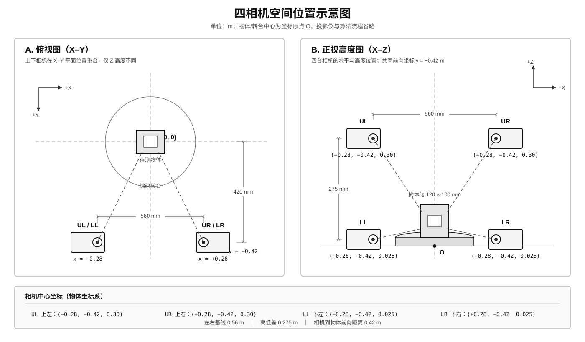
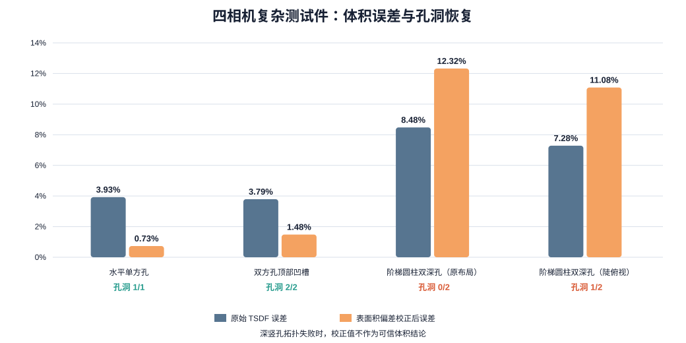

# 四相机复杂物体扩展实验

## 1. 扩展目标

两路上下互补系统已经证明观测几何比单纯增加同侧相机更重要。四相机阶段不是改用另一条技术路线，而是在原有“相移结构光 + 多基线 + 编码转台 + 三维重建”主线上，把观测阵列扩展为：

- `upper_left`、`upper_right`：两台上位相机，保证外表面、孔底和上侧斜面的横向基线覆盖；
- `lower_left`、`lower_right`：两台低位相机，补充孔顶、下侧内壁和低位遮挡区；
- 上、下观测组分别共享一个投影位姿，形成两个互补投影方向；仿真中按支路时分采集；
- 物体仍按 30° 步长旋转 12 个已知角度，不依赖纯 ICP 猜测位姿。

每个物体共采集：

\[
4\ \text{相机}\times12\ \text{转台角度}\times3\ \text{频率}\times4\ \text{相位}=576\ \text{帧}。
\]

三频为 1、4、12 周期，四步相位为 0°、90°、180°、270°。所有正式重建仍从线性条纹图像解码并三角测量，BlenderProc 深度只用于误差评价。

## 2. 四相机位置与标定

四个观测支路各自保存相机内参、相机外参和对应投影仪参数：

| 支路 | 标定文件 | 主要作用 |
| --- | --- | --- |
| 上左 | `configs/sim_calibration_fourcam_upper_left.npz` | 上表面、左侧内壁和远端轮廓 |
| 上右 | `configs/sim_calibration_fourcam_upper_right.npz` | 上表面、右侧内壁和远端轮廓 |
| 下左 | `configs/sim_calibration_fourcam_lower_left.npz` | 下侧遮挡区和孔顶补偿 |
| 下右 | `configs/sim_calibration_fourcam_lower_right.npz` | 下侧遮挡区和孔顶补偿 |

深竖孔附加实验将上方两台相机提高到更陡的俯视角，并使用：

- `configs/sim_calibration_fourcam_steep_upper_left.npz`
- `configs/sim_calibration_fourcam_steep_upper_right.npz`

陡俯视相机约位于 `[-0.07, -0.07, 0.50] m` 和 `[0.07, -0.07, 0.50] m`，投影仪约位于 `[0, 0.08, 0.52] m`。这是对深孔可见性的针对性改动，不是对所有物体默认使用的布局。

## 3. 重建与评价方法

### 3.1 图像到点云

每个支路独立执行：四步相位解码、1→4→12 多频展开、调制度和亮度筛选、投影坐标一致性检查、相机射线与投影列平面三角测量。各视角点云再按转台角度逆旋转到物体坐标系。

### 3.2 双分支融合

- **ROI-TSDF 体积分支**：四支路深度共同积分，保留物体物理 ROI 内的主连通分量；同时报告原始体积、表面积偏差校正体积、边界边和 `watertight` 状态。
- **定向点云 Poisson 拓扑分支**：按各相机视点统一法向，融合四支路点云后降采样并重建；在指定截面检查孔洞闭环、尺寸和中心位置。
- **可信度规则**：只有体积和拓扑同时合理时才判为成功。若 Poisson 填孔、重复成环或 TSDF 拓扑错误，不能因为某个体积数字接近真值就判定成功。

相关实现入口：

- `reconstruction/tsdf_fusion_multi_camera.py`
- `reconstruction/poisson_from_multi_points.py`
- `evaluation/evaluate_multi_hole_section.py`

## 4. 实验结果

| 测试件 | 真值/cm³ | TSDF 原始误差 | 校正误差 | 目标孔 | 恢复孔 | 拓扑结论 |
| --- | ---: | ---: | ---: | ---: | ---: | --- |
| 水平单方孔 | 1008.000 | 3.926% | **0.732%** | 1 | 1 | 通过 |
| 双方孔 + 顶部凹槽 | 1124.500 | 3.790% | **1.482%** | 2 | 2 | 通过，但右孔横向尺寸有偏差 |
| 阶梯圆柱双深孔（原布局） | 858.127 | 8.479% | 12.324% | 2 | 0 | 失败 |
| 阶梯圆柱双深孔（陡俯视） | 858.127 | 7.282% | 11.083% | 2 | 1 | 失败，仅恢复一个偏小候选孔 |

完整逐项数据见 `artifacts/results/four_camera_experiments.csv` 和 `four_camera_summary.json`。

### 4.1 水平单方孔

- TSDF 原始体积：968.425 cm³；
- 表面积偏差校正体积：1015.376 cm³；
- 校正误差：0.732%；
- 主网格边界边：1376；
- Poisson 截面恢复一个 40.326 × 40.506 mm 闭合孔；
- 相对 40 × 40 mm 真值，两个方向尺寸误差为 0.814% 和 1.264%。

相较单相机 1.006% 和同侧双相机 1.103% 的体积误差，四相机结果更低，并且恢复了两种基线均未得到的闭合孔截面。与此前上下互补双路 0.726% 相比，四相机体积误差基本持平而非严格更优；四相机的价值主要体现在横向覆盖冗余和边界连续性。

### 4.2 双方孔与顶部凹槽

该物体同时包含非凸顶部和两个 25 × 35 mm 方孔，用于验证阵列能否处理多个相邻拓扑结构。

- TSDF 校正体积：1141.160 cm³，对 1124.500 cm³ 真值误差 1.482%；
- 左孔：25.898 × 33.653 mm；
- 右孔：22.719 × 33.843 mm；
- 四个尺寸方向的平均相对误差约 4.97%；
- 两个目标孔均形成闭环。

Poisson 的收紧 ROI 版本出现右孔重复闭环，因此最终拓扑结果选用直接融合版本，并用尺寸阈值排除小于 10 mm 的伪环。这个选择和失败版本都保留在公开日志中。

### 4.3 阶梯圆柱与双深竖孔

该物体含两级曲面、四个底脚和两个直径 24 mm、中心距 36 mm 的高深宽比竖孔。它暴露了当前方法的明确边界：

- 原四相机布局的 TSDF 与 Poisson 都填平两个深孔；
- 陡俯视布局将孔区相移有效率提高到约 90.7%–98.9%，证明图像调制度不是主要瓶颈；
- 但融合后只得到一个 18.712 × 16.369 mm 的偏小候选孔，平均直径误差约 26.9%；
- 原始体积误差从 8.479% 改善到 7.282%，仍不足以通过；
- 拓扑错误时表面积校正反而把误差放大到 11.083%，因此该校正值不作为可信结论。

失败原因更可能位于深孔底部/内壁采样、跨视角法向一致性和隐式表面闭合，而不是相移图本身。后续实物方案应优先考虑更窄投影夹角、轴向专用补光/投影、主动选视角，或把“无法观测的深孔”作为测量范围约束。

## 5. 与单相机、双相机的关系

四相机不是为了用更多硬件掩盖算法问题，而是把已验证有效的上下互补几何扩展成左右冗余阵列：

| 方案 | 观测几何 | 水平孔体积误差 | 闭合孔 | 结论 |
| --- | --- | ---: | ---: | --- |
| 单相机 | 上方单基线 | 1.006% | 0 | 外表面可用，内壁缺失 |
| 同侧双相机 | 上方左右基线，共同照明盲区 | 1.103% | 0 | 相机增加但孔仍未闭合 |
| 上下互补双路 | 一上一路 + 互补投影 | **0.726%** | 1 | 体积精度最佳值，与四相机基本持平 |
| 四相机 | 上左右 + 下左右，互补投影 | **0.732%** | 1 | 增加冗余覆盖，并通过双方孔复杂件 |

因此准确表述是：四相机方案明显优于当前单相机和同侧双相机基线；相对最佳上下互补双路，它没有在单方孔体积误差上形成显著优势，但扩展了覆盖冗余，并在双方孔非凸物体上得到可用结果。

## 6. 对赛题二技术路线的忠实性

四相机扩展仍然忠实于既定路线：

1. 传感原理仍是主动相移结构光，不是 NeRF、单目深度网络或商业扫描黑盒；
2. 每个三维点仍由相机—投影仪几何三角测量得到；
3. 多相机只是增加多基线和遮挡互补，没有用 Blender 深度替代测量；
4. 编码转台角度仍用于跨视角刚性变换；
5. TSDF 和 Poisson 分别服务于体积与拓扑，且失败状态进入质量控制；
6. 参数化模型提供体积和孔尺寸真值，所有结果可由公开脚本重新计算。

需要注意，四相机属于赛题路线的工程增强，不代表真实硬件已完成。相机、投影仪、转轴联合标定，硬件同步，真实材料和标准件验证仍必须在实物阶段完成。

## 7. 可复现证据

- 服务器完成状态：`artifacts/results/fourcam_*_status.txt`；
- 原始体积/网格指标：`artifacts/results/fourcam_*_metrics.txt`；
- 脱敏运行日志：`artifacts/logs/*fourcam*.log`、`complex_*.log`、`curved_*.log`；
- 统一结果：`artifacts/results/four_camera_experiments.csv`；
- 结构化摘要：`artifacts/results/four_camera_summary.json`；
- 完整命令：`docs/reproduction.md`；
- 大体积 HDF5/PLY 不进入 Git，但可由 `pipelines/` 重新生成。

