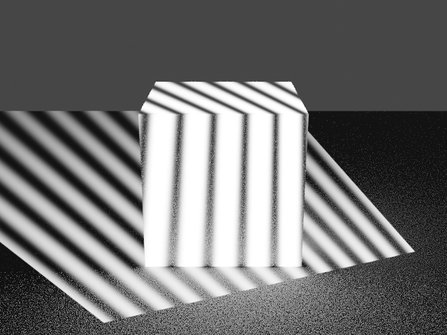
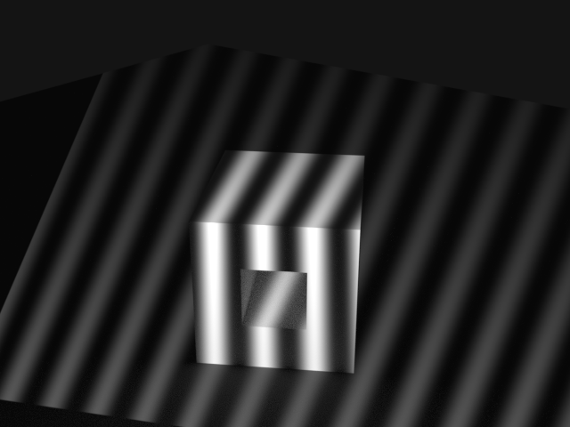
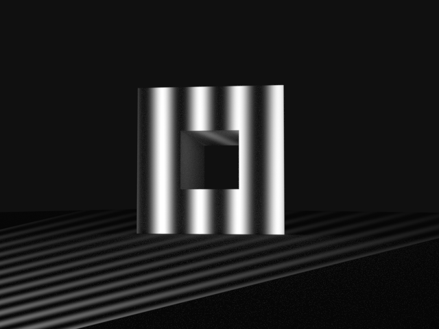
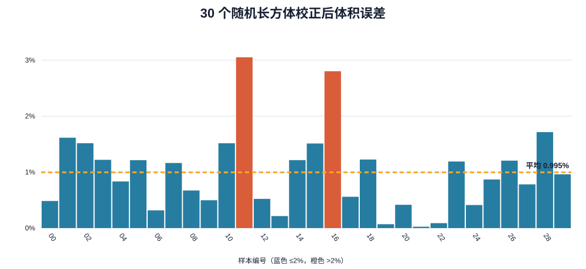
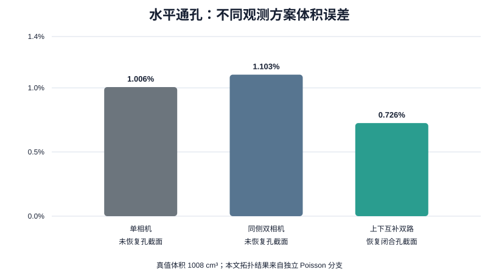
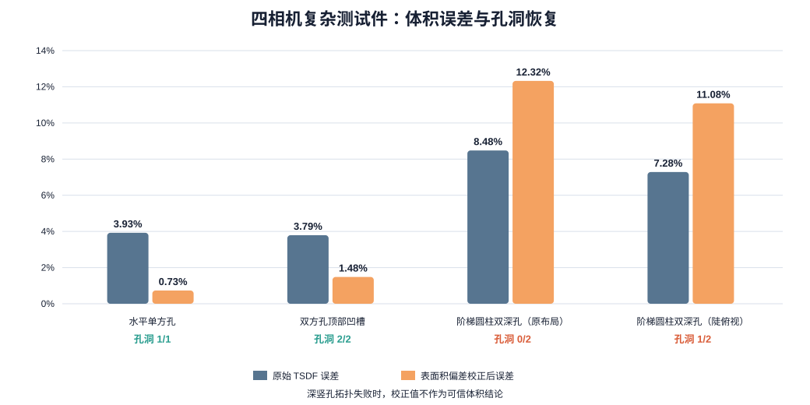

# 多视角相移结构光体积测量仿真报告

## 摘要

本项目针对第十五届全国大学生光电设计竞赛赛题二，构建了基于 BlenderProc/Cycles 的相移结构光仿真平台，实现了从参数化物体、独立相机—投影仪成像、多频四步相移解码、三角测量、转台多视角融合到体积与拓扑评价的完整闭环。

在 30 个随机长方体实验中，全部样本完成 6 视角、72 幅图像的重建，表面积偏差校正后的体积平均相对误差为 0.995%，中位数 0.915%，P95 2.313%，最大值 3.051%，其中 93.3% 样本误差不超过 2%。在水平通孔测试件上，单相机和同侧双相机均无法形成有效闭合孔截面；上下互补双路恢复了 40.69 × 40.54 mm 的闭合孔，体积误差 0.726%。进一步扩展的四相机阵列在水平孔上得到 0.732% 体积误差和 40.33 × 40.51 mm 闭合孔，并在双方孔非凸件上恢复 2/2 个目标孔；但对阶梯圆柱的高深宽比竖孔仍然失败。成功和失败案例共同用于界定方法适用范围。

## 1. 平台目标

平台用于回答三个问题：

1. 原定“多视角相移结构光 + 双相机多基线 + 编码转台 + 拓扑保持重建”路线能否形成完整计算闭环；
2. 单相机、常规同侧双相机和上下互补双路在孔洞场景中的差异是什么；
3. 在进入硬件采购与搭建前，哪些算法参数、失败模式和质量控制规则需要固化。

平台不把 BlenderProc 深度直接当作结构光结果。渲染深度只作为真值；正式重建由条纹图像经过相位解码和几何三角测量得到。

## 2. 仿真环境

| 项目 | 配置 |
| --- | --- |
| 仿真框架 | BlenderProc 2.8.0 |
| 渲染器 | Blender 4.2.1 LTS / Cycles |
| 计算设备 | NVIDIA RTX 4090 / OptiX；CPU 同时可见 |
| 分辨率 | 640 × 480 |
| 每帧样本 | 128 |
| 输出 | 线性 float32 EXR/HDF5、深度、法向 |
| 相移编码 | 1/4/12 周期，四步相移 |
| 多视角 | 6 视角（随机长方体）或 12 视角（通孔） |
| 重建 | NumPy、SciPy、OpenCV、Open3D 0.19.0、Trimesh |

## 3. 实验对象

### 3.0 仿真渲染示例

下图显示独立投影仪投射的正弦条纹能够随物体表面产生连续形变和遮挡，而不是把二维纹理直接贴到相机图像上。

为解决水平通孔的共同阴影，先测试第二台同侧相机，再增加低位相机—投影仪对。两幅图采用相同类型条纹，但观察高度和照明方向不同。

| 第二台同侧相机 | 低位互补相机—投影仪 |
| --- | --- |
|  |  |

### 3.1 标准立方体

真值为 4096 cm³。早期稳健点云体积结果为 4113.996 cm³，误差 0.439%，用于检查尺度一致性。最终 TSDF 链路在该立方体上得到原始体积 4005.141 cm³，并据此估计 0.702765548 mm 的等效表面偏移；因此校正后的立方体本身属于**标定结果**，不作为独立泛化精度。后续随机长方体、L 形和通孔才是该校正量的验证对象。

### 3.2 随机长方体

固定随机种子生成 30 个不同长宽高样本。每个样本采用 6 个转台角度，每个角度包含 3 个频率 × 4 个相位，共 72 幅图。尺寸、真值和逐样本结果完整公开在 `artifacts/results/random_cuboids_benchmark.csv`。

### 3.3 L 形非凸物体

用于验证凸包不适合非凸体积。凸包方法误差为 17.289%；TSDF 主网格的原始体积为 3002.640 cm³，经同一表面积偏差项校正为 3083.927 cm³，相对 3072 cm³ 真值误差 0.388%。这项实验说明不能用“对点云求凸包”作为复杂物体主体积方法。

### 3.4 水平通孔测试件

外形约 120 × 100 × 100 mm，中间沿 X 方向设置 40 × 40 mm 方形贯通孔，真值体积 1008 cm³。该测试件用于区分“外部体积数值接近”和“孔拓扑真正恢复”。

## 4. 随机长方体批量结果

| 指标 | 数值 |
| --- | ---: |
| 成功样本 | 30/30 |
| 平均误差 | 0.995% |
| 中位误差 | 0.915% |
| P95 | 2.313% |
| 最大误差 | 3.051% |
| ≤1% | 53.3% |
| ≤2% | 93.3% |
| ≤3% | 96.7% |

最大误差样本是 `cuboid_011`：138.9 × 69.8 × 52.0 mm，真值 504.151 cm³，校正值 488.769 cm³，误差 3.051%。该样本高度较低、长宽比明显，薄边界区域更容易受体素离散与表面偏移模型影响。

## 5. 单相机、常规双相机与本文方案对比

所有方法使用同一水平通孔真值 1008 cm³、同一相移编码、相同 12 个转台角度和一致的体积校正方法。

| 方法 | 校正体积/cm³ | 相对误差 | 有效闭合孔截面 | 结论 |
| --- | ---: | ---: | --- | --- |
| 单相机上方基线 | 1018.144 | 1.006% | 0 | 体积可用，孔内壁覆盖不足 |
| 同侧双相机 | 1019.119 | 1.103% | 0 | 增加相机仍未解除共同投影阴影 |
| 上下互补双路 TSDF | 1015.315 | **0.726%** | TSDF 为 0 | 三种配置中体积误差最低 |
| 上下互补双路 Poisson | 不用于体积 | — | **1** | 恢复 40.69 × 40.54 mm 内孔闭环 |

相对于单相机，上下互补双路的体积相对误差降低约 27.9%；相对于同侧双相机降低约 34.2%。更重要的是，只有上下互补采集加定向点云拓扑分支恢复了目标孔洞。

### 5.1 为什么普通双相机没有自然变好

两台相机都位于物体上方时，即使水平基线不同，孔内仍存在投影仪无法照亮的共同阴影区域。参数扫描改变 TSDF 形态学核、迭代次数和最小连通区域，只产生小于 1 mm 的伪闭环，未得到约 40 mm 的真实孔截面。这表明问题来自观测几何，而不是继续调整网格参数即可解决。

### 5.2 上下互补观测的作用

覆盖率诊断表明，上路对孔底和一侧内壁覆盖较好，下路对孔顶覆盖达到约 90%，两者具有真实互补性。联合后，TSDF 体积误差下降；进一步直接融合上下原始点云并按相机位置定向法向，Poisson 中截面出现一个约 40 mm 的闭合内环。

## 6. 四相机复杂物体扩展

四相机系统由上左、上右、下左、下右四个相机—投影几何支路组成。每个物体使用 12 个转台角度、3 个频率和 4 个相位，共渲染 576 帧，并独立完成 48 个“相机 × 视角”点云重建。TSDF 负责定量体积，定向点云 Poisson 负责截面拓扑。

| 测试件 | 真值/cm³ | 原始误差 | 校正误差 | 恢复孔/目标孔 | 结论 |
| --- | ---: | ---: | ---: | ---: | --- |
| 水平单方孔 | 1008.000 | 3.926% | **0.732%** | 1/1 | 通过，孔尺寸 40.33 × 40.51 mm |
| 双方孔 + 顶部凹槽 | 1124.500 | 3.790% | **1.482%** | 2/2 | 通过，尺寸平均误差约 4.97% |
| 阶梯圆柱双深孔（原布局） | 858.127 | 8.479% | 12.324% | 0/2 | 失败 |
| 阶梯圆柱双深孔（陡俯视） | 858.127 | 7.282% | 11.083% | 1/2 | 失败，候选孔尺寸偏小 |

四相机在水平单孔上明显优于当前单相机和同侧双相机基线；与最佳上下互补双路的 0.726% 相比，其 0.732% 体积误差属于基本持平，不能表述为所有指标都更优。四相机的新增证据是左右覆盖冗余和双方孔复杂件的成功恢复。

深竖孔实验则证明“相移有效”不等于“最终拓扑必然正确”。陡俯视相机把孔区有效相位比例提高到约 90.7%–98.9%，但隐式表面仍填孔，只恢复一个 18.71 × 16.37 mm 候选孔，而真值直径为 24 mm。拓扑错误时，表面积偏差校正会放大误差，因此此类结果只报告原始体积并判定失败。详见[四相机复杂物体扩展实验](four_camera_extension.md)。

## 7. 失败实验和方法选择

本仓库保留以下失败结果：

- 8 位/错误色彩管理导致不同相移渲染几乎相同；
- Open3D 0.20.0 在当前浮点深度路径上得到空 TSDF，最终固定 0.19.0；
- 凸包对 L 形物体误差 17.289%；
- 切片法对 L 形物体误差 80.901%；
- 视觉外壳对 L 形物体误差 32.594%–40.759%；
- 单纯增加同侧第二相机没有恢复通孔；
- TSDF 参数扫描没有恢复真实尺度的孔内环；
- Poisson 虽恢复孔洞，但体积高估 17.02%。
- 深竖孔原四相机布局没有恢复任何孔；陡俯视布局仍只恢复 1/2 个偏小孔；
- 双方孔 Poisson 收紧 ROI 版本产生重复孔环，最终选用直接融合版本并公开该消融日志。

这些结果直接推动了最终“双路观测 + 双分支重建”的选择。

## 8. 数据真实性和可复现性

- 批量长方体结果逐样本公开，不只给平均数；
- 日志由实际服务器运行记录脱敏得到，保留命令输出、失败信息和运行版本；
- 校正前后体积同时公开；
- `watertight=False`、边界边数量和连通分量均保留，不把非闭合网格包装为闭合结果；
- Poisson 拓扑结果与 TSDF 体积结果分开报告；
- 所有关键图表由公开 CSV 脚本生成；
- 原始 HDF5/PLY 因体积较大未纳入 Git，可按公开配置重新生成。

## 9. 结论

仿真结果支持以下结论：

1. 多频四步相移、独立相机—投影仪三角测量和转台多视角融合形成了可运行闭环；
2. 对简单和随机规则体，当前体积链路平均误差约 1%；
3. 非凸物体不能依赖凸包，通孔不能依赖全局自动补洞；
4. 同侧双相机无法解决共同投影阴影，上下互补的观测几何比单纯增加相机更有效；
5. 四相机阵列保持同一技术路线，在单孔任务上与最佳上下双路体积精度持平，并在双方孔非凸件上恢复 2/2 个孔；
6. 高深宽比竖孔仍是明确失败边界，不能用表面积校正掩盖拓扑错误；
7. 最终采用 ROI-TSDF 定量体积与定向点云 Poisson 拓扑判定的双分支方法；
8. 该方案在仿真算法层面忠实于赛题二路线，但必须经过真实硬件标定和标准件实验后才能声称实物精度。

