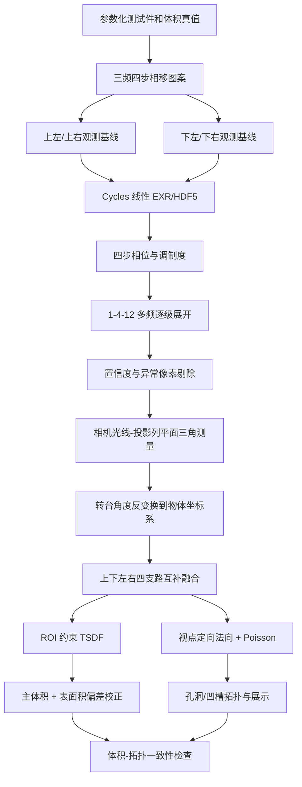

# 技术路线与赛题二一致性

## 1. 赛题目标如何转化为工程问题

赛题二要求非接触测量复杂物体体积，重点不是只对规则立方体给出一个数，而是需要同时处理外表面精度、遮挡、凹槽/孔洞可见性、跨视角配准、网格拓扑和体积可信度。因此本项目把任务分解为六个连续问题：

1. 如何投射并采集具有稳定相位关系的编码条纹；
2. 如何从图像得到相机像素与投影仪像素的对应关系；
3. 如何用相机—投影仪几何恢复三维点；
4. 如何将多个转台视角、多套观测基线统一到同一坐标系；
5. 如何在不错误封闭真实通孔的前提下获得可计算体积的表面；
6. 如何用真值、置信度和对照实验判断结果是否可信。

这六项与原定“多视角相移结构光 + 双相机多基线 + 编码转台 + 拓扑保持三维重建”技术路线一一对应。

## 2. 最终技术路线

### 2.1 编码与采集

- 图案频率：1、4、12 周期；
- 每个频率四个相位：0°、90°、180°、270°；
- 每个视角 12 幅条纹图；
- 线性浮点 EXR/HDF5，避免 8 位 gamma 编码造成相位失真；
- Cycles 开启真实阴影和遮挡，投影仪与相机具有独立位姿；
- 默认 12 个转台角度：0° 到 330°，步长 30°。

### 2.2 多相机多基线不是简单复制相机

项目依次验证了四种配置：

| 配置 | 几何特点 | 主要问题/优势 |
| --- | --- | --- |
| 单相机上方基线 | 一台上方相机 + 一台上方投影仪 | 外表面稳定，但孔内上壁/侧壁存在共同不可见区 |
| 同侧双相机 | 两台相机均在物体上方，共用上方照明方向 | 增加水平视角，但无法解除投影阴影造成的共同不可见性 |
| 上下互补双路 | 上、下各一套相机—投影仪基线 | 上方负责外表面/孔底侧，下方补充孔顶与被遮挡内壁 |
| 四相机互补阵列（最终扩展） | 上左、上右、下左、下右四台相机，上/下两组共享两个投影位姿并时分采集 | 保留高低互补，同时增加左右冗余和多孔覆盖 |

因此，创新点不是机械增加相机数量，而是先证明**高低基线和照明方向互补**有效，再扩展为左右冗余的四相机阵列。这与原技术路线中“多基线兼顾外表面精度和孔槽可见性”的目的保持一致。水平单孔上，四相机 0.732% 与上下双路 0.726% 基本持平；四相机的新增价值是通过双方孔非凸件，而不是宣称相机越多体积数字必然越好。

### 2.3 解码和置信度

每个频率先完成四步相位解码，再用 1→4→12 周期逐级确定条纹阶次。有效点必须同时满足：

- 深度真值/仿真裁剪范围有效；
- 平均亮度不低于阈值；
- 调制度与平均亮度比不低于阈值；
- 不饱和；
- 1→4、4→12 两次展开残差不超过阈值；
- 投影坐标位于投影仪范围；
- 局部投影坐标与中值邻域一致；
- 三角测量距离与局部深度邻域一致；
- 三维点位于物体 ROI。

这使“置信度驱动测量”落到像素级实现，而不是只在报告中描述。

### 2.4 三角测量

相机像素通过相机内参和外参变为世界坐标射线。单个投影仪列由投影仪光心、该列顶部射线和底部射线定义一个光平面。相机射线与投影列平面的交点即为结构光三维点。这个过程使用解码结果而非 BlenderProc 真值深度；真值深度只用于误差评价。

### 2.5 转台多视角融合

每个角度的点云先按已知转台角度执行逆旋转，恢复到 0° 物体坐标系。仿真阶段使用真值角度验证算法闭环，实物阶段应替换为编码器角度和转轴标定结果。系统不依赖纯 ICP 猜测初始位姿，避免对称物体错配。

### 2.6 体积和拓扑分开优化

单一网格算法无法同时保证体积稳定和通孔拓扑正确：

- TSDF 在定量体积上更稳定，但稀疏内壁容易留下开边界；
- Poisson 能形成连续孔截面，但会在未观测区域外推，导致本例体积高估约 17%，不能作为主体积结果。

最终采用双分支：

- **正式体积**：ROI 约束 TSDF 主连通分量体积，加标准立方体标定得到的表面积偏差项；
- **拓扑判定**：多支路点云按各相机视点定向法向后进行 Poisson，并检查指定截面的闭合内环数量、尺寸和中心位置；
- **可信度规则**：Poisson 只证明孔洞拓扑和用于展示，不使用其体积；TSDF 非 watertight 状态必须公开记录。

## 3. 与赛题二路线的逐项证据矩阵

| 赛题/原路线要求 | 仿真实现 | 代码入口 | 实验证据 | 当前边界 |
| --- | --- | --- | --- | --- |
| 非接触光学测量 | 独立相机和投影仪模型、条纹光照 | `simulator/single_phase_capture*.py` | 条纹烟雾测试与完整渲染日志 | 尚未完成真实硬件同步 |
| 相移结构光 | 三频四步相移 | `reconstruction/unwrap_multifrequency_16bit.py` | 四相图差异、调制度和有效率日志 | 未加入真实相机响应噪声标定 |
| 自研三维恢复 | 投影列平面三角测量 | `reconstruction/triangulate.py` | 仿真真值 RMSE/中位数/P95 | 仿真真值仅用于评价 |
| 多相机多基线 | 单相机/同侧双相机对照 + 上下双路 + 四相机互补阵列 | `reconstruction/tsdf_fusion_dual_camera.py`、`tsdf_fusion_multi_camera.py` | 单孔、双方孔和深孔对比 | 多照明方向必须在硬件中实现或时分切换 |
| 多视角/转台 | 6/12 角度批量渲染和逆旋转 | `simulator/batch_render_*.py`、`reconstruction/tsdf_fusion.py` | 30 个随机长方体均完成 6 视角重建 | 未注入真实转台回差和偏心 |
| 复杂形貌 | 立方体、L 形、水平孔、双方孔凹槽、阶梯曲面深孔、随机长方体 | `simulator/single_phase_capture_*.py` | 规则、非凸、多孔、曲面与失败边界 | 反光、黑色、半透明和真实盲孔仍需补测 |
| 拓扑保持 | TSDF 体积 + Poisson 拓扑双分支 | `tsdf_fusion*.py`、`poisson_from_*_points.py` | 单孔和双方孔闭环；深竖孔失败 | Poisson 网格非 watertight，深孔可能被填平，且不用于体积 |
| 体积真值闭环 | 参数化尺寸生成真值，逐样本 CSV | `render_random_cuboids.py`、`run_cuboid_benchmark.py` | 30/30，平均误差 0.995% | 偏差校正目前由一个标准立方体得到，实物需多标准件交叉验证 |
| 置信度/鲁棒性 | 调制度、饱和、展开、空间和局部深度筛选 | 解码与三角测量脚本 | 有效像素率、失败参数扫描、原始日志 | 尚未实现自动补拍控制器 |
| 可开源复现 | 源码、配置、脱敏日志、原始指标、命令 | 本仓库 | `artifacts/` 与文档 | 原始渲染/点云因体积未纳入 Git，可按脚本生成 |

## 4. 对“忠实”的准确表述

本项目在**仿真和算法层面忠实实现了赛题二既定主线**：结构光编码、多相机多基线、转台多视角、拓扑保持重建和体积真值评估均有代码与实验依据。四相机只是对既定双相机多基线路线的工程扩展，三维点仍由条纹相位和相机—投影仪几何得到；它不是脱离赛题的纯视觉 NeRF、单纯深度相机或商业扫描方案。

但“忠实”不等于“已经完成实物验收”。以下环节仍属于下一阶段：

1. 工业相机、投影仪与转台的硬件触发同步；
2. 相机/投影仪/多相机/转轴联合标定；
3. 真实材料、环境光、反光和暗表面实验；
4. 转台回差、轴偏心和温漂误差预算；
5. 用多个有证书标准件重新估计体积偏差，不直接照搬仿真校正量；
6. 将低置信度区域转化为自动补拍角度或照明切换。

这种边界说明是为了保证开源结果真实可审计，而不是削弱当前成果。

